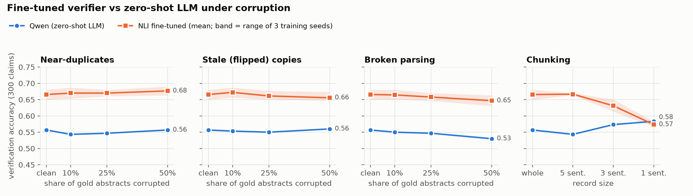
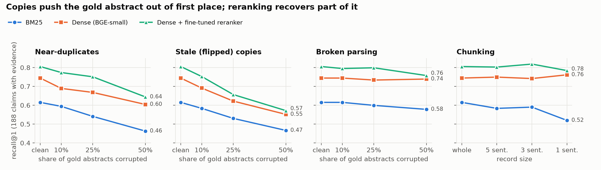
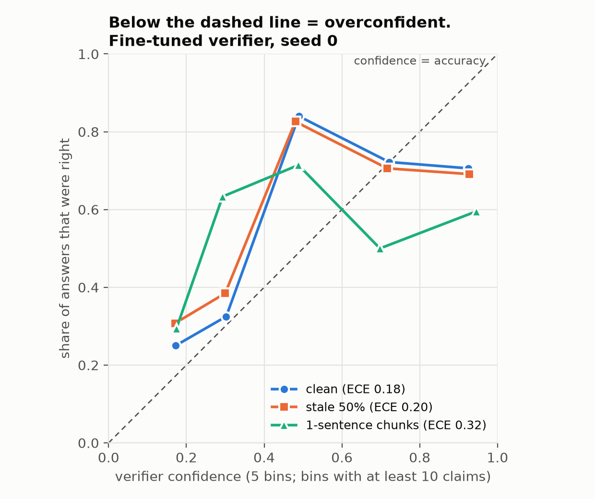
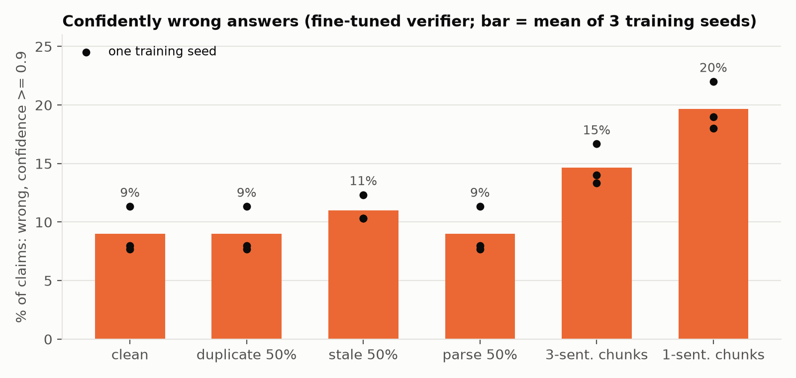

# RAG Data-Quality Benchmark

**Question:** how do data-quality defects in a document collection (duplicates, broken parsing,
stale or conflicting versions, chunking choices) change the accuracy of retrieval-augmented answers?

**Data:** SciFact (Wadden et al., EMNLP 2020): 5,183 scientific abstracts and expert-written claims
labelled SUPPORT / CONTRADICT (or no evidence, treated as NOT_ENOUGH_INFO). The dev split
(300 claims: 124 SUPPORT, 64 CONTRADICT, 112 NOT_ENOUGH_INFO) is used for evaluation.

## Key findings

Pipeline: BM25 or dense retrieval (BGE-small) over the abstracts, then a verifier labels each claim
from the top-3 retrieved records. Defects were injected into the gold-evidence abstracts at 10-50%.
The findings below held across both corruption seeds and, for the fine-tuned verifier, all three
training seeds; details and caveats are in the weekly sections.

1. **Duplicate and stale copies push the gold abstract out of first place.** Dense recall@1 falls
   from 0.744 to about 0.57-0.60 (duplicates, 50%) and 0.49-0.55 (stale, 50%), yet the gold abstract
   stays in the top 10. A fine-tuned reranker recovers part of the duplicate loss but little of the
   stale loss: a flipped copy is as relevant to the claim as the original.
2. **Broken parsing barely affects retrieval but costs verification.** In no parse setting did a
   verifier gain more correct answers than it lost, and at 25-50% it lost clearly more: for Qwen
   (corruption seed 0), for all three fine-tuned training seeds, and on both corruption seeds.
3. **Single-sentence chunks make the fine-tuned verifier both less accurate and more confident.**
   Accuracy drops from 0.65-0.68 to 0.57-0.58 and confidently wrong answers (confidence >= 0.9)
   roughly double, to about 20% of claims.
4. **How a verifier reacts to conflicting evidence depends on the verifier.** The zero-shot LLM
   (Qwen2.5-1.5B) mostly ignores flipped copies; the fine-tuned NLI verifier moves towards
   CONTRADICT when it sees one. Neither changes overall accuracy significantly.
5. **A small verifier fine-tuned on SciFact beats the zero-shot LLM** (0.666 mean accuracy against
   0.557 on the clean corpus) and stays ahead on every corrupted corpus except 1-sentence chunks.
   This comparison is expected to favour the fine-tuned model, which saw in-domain training data;
   the robustness findings above are the main result. It is overconfident even on clean data.

Figures: `figures/` (shown in the Week 4 section).

## Week 1: clean baseline (complete)

```bash
pip install -r requirements.txt
python week1_baseline.py --step download
python week1_baseline.py --step retrieve   # BM25 vs dense (BGE-small + FAISS), recall@1/3/5/10
python week1_baseline.py --step verify     # open LLM (Qwen2.5-1.5B-Instruct) labels each claim from top-3 dense abstracts
python analyze_week1.py                    # per-class metrics, confusion matrix, majority baseline
```

### Retrieval (188 dev claims with gold evidence documents)

| Retriever | R@1 | R@3 | R@5 | R@10 |
|---|---|---|---|---|
| BM25 (whitespace tokens) | 0.615 | 0.770 | 0.819 | 0.883 |
| Dense: BGE-small-en-v1.5 + FAISS (cosine) | **0.744** | **0.859** | **0.898** | **0.957** |

### Claim verification (all 300 dev claims, zero-shot, top-3 dense abstracts as context)

| System | Accuracy | Macro-F1 |
|---|---|---|
| Majority class (always SUPPORT) | 0.413 | 0.195 |
| Qwen2.5-1.5B-Instruct, greedy, one-word answer | **0.557** | **0.502** |

Per class (precision / recall / F1): SUPPORT 0.540 / 0.871 / 0.667; CONTRADICT 0.447 / 0.328 / 0.378;
NOT_ENOUGH_INFO 0.717 / 0.339 / 0.461. The model predicts SUPPORT for 200 of 300 claims.

A gold abstract was in the top-3 context for 87.2% of evidence claims (164/188). On those claims
accuracy was 0.701; on the 24 claims without it, 0.583 (small sample; the model often still
answers SUPPORT without the evidence being present).

Raw outputs: `results/week1_retrieval.json`, `results/dense_rankings.json`,
`results/week1_verification.json` (every prediction and raw model answer), `results/week1_analysis.json`.

### Environment for the reported numbers

CPU only (2 vCPU Intel Xeon 2.10 GHz, 7 GB RAM, no GPU). Python 3.11, torch 2.14.0+cpu,
transformers 5.17.0, sentence-transformers 6.1.0, faiss-cpu 1.15.1, scikit-learn 1.8.0.
The LLM runs in bfloat16 on CPU (float16 on GPU). Decoding is greedy, so results are deterministic
up to numerical differences across hardware. Runtime: dense encoding about 11 min, verification about 21 min.

## Week 2: corrupted corpora (complete)

`corrupt_corpus.py` writes a corrupted copy of the corpus to `data/corrupted/<name>/`, with a
`manifest.json` listing every changed document. Claims and gold labels are never changed.

| Defect | What it does | Options |
|---|---|---|
| `duplicate` | adds near-duplicate copies (one sentence dropped, ~5% of words deleted, one word pair swapped per sentence) | `--rate`, `--copies` |
| `parse` | replaces documents in place with a broken parse: truncated mid-text, sentence order scrambled, or OCR-style character noise | `--rate` |
| `stale` | adds a conflicting copy with directional findings flipped by rule (increased/decreased, higher/lower, "is associated" to "is not associated", ...) | `--rate` |
| `chunk` | splits every abstract into chunks of N sentences | `--chunk-size` |

`--target gold` (default) samples only from the 184 documents that are gold evidence for a dev
claim, so the defects reach the evaluated claims; `--target all` samples from the whole corpus.
`--seed` (default 0) makes every corruption reproducible.

```bash
python corrupt_corpus.py --defect stale --rate 0.25      # -> data/corrupted/stale_r0.25_gold_s0/
python week1_baseline.py --step retrieve --corpus data/corrupted/stale_r0.25_gold_s0/corpus.jsonl
python week1_baseline.py --step verify   --corpus data/corrupted/stale_r0.25_gold_s0/corpus.jsonl
python analyze_week1.py --run stale_r0.25_gold_s0        # results in results/stale_r0.25_gold_s0/
```

Models, prompt and decoding are identical to Week 1, so any change comes from the corpus.
Scoring rules: a duplicate or stale copy is a different document, so retrieving it does not
count as retrieving the gold abstract. A chunk counts as its parent document, and recall@k is
computed over the first k distinct parent documents. The LLM context is still the top-3
retrieved records (chunks, for a chunked corpus).

To run the whole grid (`duplicate`, `parse`, `stale` at rates 0.1 / 0.25 / 0.5; `chunk` at 1 / 3 / 5
sentences) and write `results/week2_summary.json`:

```bash
python run_week2.py                 # retrieve + verify + analyze everything (GPU advised)
python run_week2.py --sparse-only   # BM25 retrieval only: no model downloads, ~2 min on CPU
python compare_week2.py             # paired claim-level comparison with the clean re-run
```

### Results (seed 0; all 13 runs)

All runs used the Week 1 models, prompt, decoding and library versions, on GitHub Actions CPU
runners (`.github/workflows/week2.yml`). `clean_rerun` re-ran the clean corpus there and matched
Week 1 exactly (every retrieval score, accuracy and confusion-matrix cell), so the differences
below come from the corpus, not the machine.

Retrieval recall over the 188 dev claims with gold evidence; verification over all 300 claims.

| Corpus | BM25 R@1 | BM25 R@10 | Dense R@1 | Dense R@3 | Dense R@10 | Accuracy | Macro-F1 |
|---|---|---|---|---|---|---|---|
| clean (Week 1 = re-run) | 0.615 | 0.883 | 0.744 | 0.859 | 0.957 | 0.557 | 0.502 |
| duplicate 10% | 0.594 | 0.883 | 0.689 | 0.857 | 0.957 | 0.543 | 0.485 |
| duplicate 25% | 0.541 | 0.883 | 0.668 | 0.853 | 0.957 | 0.547 | 0.492 |
| duplicate 50% | 0.463 | 0.883 | 0.604 | 0.846 | 0.957 | 0.557 | 0.496 |
| stale 10% | 0.583 | 0.883 | 0.691 | 0.857 | 0.957 | 0.553 | 0.500 |
| stale 25% | 0.530 | 0.883 | 0.622 | 0.854 | 0.957 | 0.550 | 0.494 |
| stale 50% | 0.466 | 0.883 | 0.551 | 0.846 | 0.957 | 0.560 | 0.503 |
| parse 10% | 0.615 | 0.883 | 0.744 | 0.857 | 0.957 | 0.550 | 0.493 |
| parse 25% | 0.599 | 0.861 | 0.734 | 0.846 | 0.957 | 0.547 | 0.491 |
| parse 50% | 0.578 | 0.845 | 0.739 | 0.847 | 0.941 | 0.530 | 0.476 |
| chunk, 1 sentence | 0.520 | 0.773 | 0.762 | 0.882 | 0.963 | 0.583 | 0.538 |
| chunk, 3 sentences | 0.590 | 0.827 | 0.742 | 0.879 | 0.963 | 0.573 | 0.531 |
| chunk, 5 sentences | 0.583 | 0.851 | 0.749 | 0.882 | 0.960 | 0.543 | 0.494 |

Accuracy differences of 1-2 points over 300 claims are within noise, so `compare_week2.py`
compares each run with `clean_rerun` claim by claim (exact McNemar test on the claims whose
correctness changed):

| Corpus | Predictions changed | Right to wrong | Wrong to right | McNemar p | Claims with a copy in the LLM context | ... of which prediction changed |
|---|---|---|---|---|---|---|
| duplicate 10% / 25% / 50% | 4 / 5 / 8 | 4 / 3 / 4 | 0 / 0 / 4 | 0.13 / 0.25 / 1.0 | 18 / 48 / 91 | 2 / 3 / 8 |
| stale 10% / 25% / 50% | 1 / 6 / 9 | 1 / 3 / 3 | 0 / 1 / 4 | 1.0 / 0.63 / 1.0 | 19 / 47 / 95 | 1 / 4 / 9 |
| parse 10% / 25% / 50% | 2 / 3 / 8 | 2 / 3 / 8 | 0 / 0 / 0 | 0.50 / 0.25 / **0.008** | | |
| chunk 1 / 3 / 5 sentences | 68 / 66 / 53 | 22 / 22 / 23 | 30 / 27 / 19 | 0.33 / 0.57 / 0.64 | | |

What this shows (one seed, 300 claims; treat as a first pass):
- **Copies displace the gold abstract at the top, for both retrievers.** At 50%, dense R@1 falls
  from 0.744 to 0.604 (duplicates) and 0.551 (stale), BM25 R@1 from 0.615 to about 0.46. The copy
  pushes the gold abstract down only one place, so R@10 does not change.
- **The verifier barely reacts to conflicting evidence.** At stale 50%, a copy with flipped
  findings sat in the LLM's top-3 context for 95 claims, yet only 9 predictions changed and only
  1 moved to CONTRADICT; accuracy is unchanged. This fits the Week 1 finding that the 1.5B model
  answers SUPPORT for two thirds of claims: it does not appear to weigh the contradiction. (Caveat:
  about 1 in 5 stale copies had no rule-based edit, see below.)
- **Broken parsing is the one defect with a consistent cost to verification.** Dense retrieval
  shrugs it off (R@10 0.941 at 50%), but every changed answer went from right to wrong: 8 of 8 at
  50% (p = 0.008), 3 of 3 at 25%, 2 of 2 at 10%.
- **Chunking hurts BM25 but not dense retrieval**, which gains slightly at the top (R@1 0.762 with
  single sentences). It changes many verification answers (53-68) in both directions with no
  significant net effect; the higher accuracy with 1-sentence chunks (0.583) is not significant
  (p = 0.33).

Per-run files: `results/<run>/` (retrieval, rankings, every prediction, analysis, corruption
manifest); all runs: `results/week2_summary.json`; paired comparison: `results/week2_paired.json`.

Reproducing on GitHub Actions: CPU runners without native bfloat16 (AVX512-BF16 or AMX; for
example the Xeon 8370C) run the bfloat16 LLM about 50x slower (~150 s per claim instead of ~3 s).
The workflow therefore stops such jobs after a CPU check; re-run the failed jobs until each lands
on a suitable runner. Settings with committed results are skipped.

Known limitation: the `stale` flips are rule-based. At rate 0.5 with seed 0, 17 of 91 stale
copies had no matching words and are identical to the original (reported as
`stale_copies_without_edits` in the manifest).

## Week 3: a fine-tuned verifier and reranker (complete)

**Verifier.** `week3_verifier.py` replaces the zero-shot LLM with an NLI cross-encoder
(`cross-encoder/nli-deberta-v3-xsmall`) that scores each (claim, abstract) pair as SUPPORT /
CONTRADICT / NOT_ENOUGH_INFO. A claim takes the strongest SUPPORT or CONTRADICT score over its
top-3 retrieved records, or NOT_ENOUGH_INFO if neither reaches a threshold. Verifiers compared,
all on the same dense top-3 context as Weeks 1-2:

- **Qwen**: the Week 1-2 zero-shot LLM.
- **NLI zero-shot**: the cross-encoder as released (general NLI training, no SciFact).
- **NLI fine-tuned**: the same model fine-tuned for 3 epochs on SciFact train (809 claims, disjoint
  from dev): gold abstracts with their labels, cited abstracts of claims without evidence as
  NOT_ENOUGH_INFO, and the top non-gold BM25 abstract as a hard NOT_ENOUGH_INFO negative
  (1,123 pairs). Trained three times (seeds 0, 1, 2; same data, different order and dropout).

Thresholds are tuned for macro-F1 on 20% of the train claims held out from training (a fixed split),
using the same dense BGE top-3 context that dev claims get; never on dev. Tuned thresholds: 0.15,
0.30 and 0.35 for seeds 0-2; 0.05 for the zero-shot model (`results/week3/seed*/training.json`).

**Reranker.** `week3_reranker.py` reorders each run's dense top-10 with a cross-encoder
(`cross-encoder/ms-marco-MiniLM-L-6-v2`), either as released (web-search training) or fine-tuned for
2 epochs on SciFact train (gold abstracts relevant; the top 4 non-gold BM25 abstracts not). The seed-0
verifier then labels each claim from the reranked top-3.

```bash
python week3_verifier.py all --seed 0     # also 1, 2; seed 0 also evaluates the zero-shot model
python week3_reranker.py train && python week3_reranker.py rerank && python week3_reranker.py verify
python week3_verifier.py summary          # results/week3/summary.json
```
(Run on CPU via `.github/workflows/week3.yml`: three seeds and the reranker in parallel, about 3 hours.)

### Verification accuracy (dev, 300 claims)

Fine-tuned: mean (standard deviation) over the three seeds.

| Corpus | Qwen | NLI zero-shot | **NLI fine-tuned** | Reranked (fine-tuned) + verifier seed 0 |
|---|---|---|---|---|
| clean | 0.557 | 0.353 | **0.666 (0.015)** | 0.657 |
| duplicate 10% / 25% / 50% | 0.543 / 0.547 / 0.557 | 0.360 / 0.367 / 0.353 | 0.670 / 0.670 / 0.677 | 0.657 / 0.667 / 0.670 |
| stale 10% / 25% / 50% | 0.553 / 0.550 / 0.560 | 0.353 / 0.357 / 0.347 | 0.672 / 0.661 / 0.656 | 0.657 / 0.657 / 0.660 |
| parse 10% / 25% / 50% | 0.550 / 0.547 / 0.530 | 0.357 / 0.347 / 0.340 | 0.664 / 0.658 / 0.647 | 0.657 / 0.650 / 0.637 |
| chunk 1 / 3 / 5 sentences | 0.583 / 0.573 / 0.543 | 0.333 / 0.353 / 0.390 | 0.573 / 0.631 / 0.667 | 0.587 / 0.657 / 0.690 |

Per-seed values, macro-F1 and paired tests are in `results/week3/summary.json`. Macro-F1 of the
fine-tuned verifier on the clean corpus: 0.631 / 0.655 / 0.647 for seeds 0-2 (Qwen 0.502).

Each fine-tuned seed against its own clean result, claim by claim (right to wrong / wrong to
right, exact McNemar p), where something moved:

| Corpus | Seed 0 | Seed 1 | Seed 2 |
|---|---|---|---|
| parse 50% | 10 / 4, p = 0.18 | 9 / 4, p = 0.27 | 8 / 2, p = 0.11 |
| stale 50% | 7 / 6, p = 1.0 | 10 / 8, p = 0.82 | 11 / 5, p = 0.21 |
| chunk 1 sentence | 58 / 38, p = 0.052 | 65 / 32, p = 0.001 | 64 / 34, p = 0.003 |
| chunk 3 sentences | 28 / 28, p = 1.0 | 42 / 27, p = 0.091 | 46 / 30, p = 0.085 |

### Reranking: retrieval (recall over the 188 claims with gold evidence)

"Dense" is the committed dense top-10 in its original order; reranking only reorders those 10
records, so recall@10 is unchanged. (For chunked corpora this dense top-10 holds fewer distinct
abstracts than Week 2's deeper ranking, so its recall@3 is slightly below the Week 2 table.)

| Corpus | Dense R@1 / R@3 | Reranked, zero-shot | **Reranked, fine-tuned** |
|---|---|---|---|
| clean | 0.744 / 0.859 | 0.760 / 0.894 | **0.805 / 0.906** |
| duplicate 50% | 0.604 / 0.846 | 0.594 / 0.887 | 0.644 / 0.903 |
| stale 50% | 0.551 / 0.846 | 0.558 / 0.891 | 0.571 / 0.903 |
| parse 50% | 0.739 / 0.847 | 0.739 / 0.866 | 0.758 / 0.878 |
| chunk 1 sentence | 0.762 / 0.872 | 0.784 / 0.885 | 0.784 / 0.883 |

All 13 runs: `results/week3/reranker/<variant>/<run>/retrieval.json`. On held-out train claims the
fine-tuned reranker lifts recall@1 of the BM25 top-10 from 0.638 to 0.743 (0.683 untuned).

### What this shows (300 claims, one corruption seed)

- **Fine-tuning a small verifier beats the zero-shot LLM, and the result holds across training
  seeds.** Accuracy 0.650 / 0.680 / 0.667 on the clean corpus (mean 0.666) against Qwen's 0.557;
  every seed is significantly better than Qwen (p = 0.005, 0.001, 0.001). The off-the-shelf NLI model
  is far worse (0.353): general NLI training does not transfer to scientific claims by itself.
- **The fine-tuned verifier stays ahead of Qwen on every corrupted corpus except single-sentence
  chunks.** Its one consistent weakness is 1-sentence chunks: all three seeds lose accuracy there
  (0.573 mean; p = 0.052, 0.001, 0.003), and 3-sentence chunks lean the same way. It was trained on
  whole abstracts.
- **Broken parsing and stale copies cost it a little, in the same direction for every seed, but
  not significantly for any one.** At parse 50%, all three seeds lost more claims than they gained
  (10/4, 9/4, 8/2). At stale 50%, more lost than gained in all three (7/6, 10/8, 11/5). Unlike
  Qwen, this verifier reacts to flipped copies: most of its changed answers move to CONTRADICT
  (see Week 4, "Stale copies that were really flipped").
- **The fine-tuned reranker clearly improves the ranking but barely changes the answers.** It puts
  the gold abstract first for 80.5% of clean claims (dense 74.4%) and recovers part of the duplicate
  loss (0.604 to 0.644), but hardly any of the stale loss (0.551 to 0.571): a flipped copy is as
  relevant to the claim as the original, so relevance ranking cannot tell them apart. Verification
  from the reranked top-3 moves by 0 to +2.3 points and no single run changes significantly
  (largest: 5-sentence chunks, 5 lost / 12 gained, p = 0.14). The gold abstract is usually already
  in the dense top-3, so better ordering inside it matters little to this verifier.

Fine-tuned models are kept as GitHub Actions artifacts (run 38033246055), not in the repository.
An earlier Week 3 run tuned thresholds on BM25 context with one seed; its seed-0 threshold and
results were identical to this run's seed 0.

## Week 4: calibration, a second corruption seed, figures (complete)

### Calibration of the fine-tuned verifier

`week4_calibration.py` gives each answer a confidence (for SUPPORT / CONTRADICT: the highest
probability of that label over the top-3 records; for NOT_ENOUGH_INFO: one minus the highest
SUPPORT or CONTRADICT probability) and compares it with correctness: ECE (10 equal-width bins),
Brier score, and the share of claims answered **wrongly with confidence >= 0.9**
(`results/week4/calibration.json`). Qwen answered with one word and no probabilities, so it is
not included.

| Corpus | Accuracy (seeds 0 / 1 / 2) | Mean confidence | ECE | Confidently wrong |
|---|---|---|---|---|
| clean | 0.650 / 0.680 / 0.667 | 0.75 / 0.79 / 0.80 | 0.18 / 0.17 / 0.14 | 11% / 8% / 8% |
| duplicate 50% | 0.663 / 0.690 / 0.677 | 0.75 / 0.80 / 0.80 | 0.19 / 0.17 / 0.15 | 11% / 8% / 8% |
| stale 50% | 0.647 / 0.673 / 0.647 | 0.76 / 0.80 / 0.81 | 0.20 / 0.19 / 0.17 | 12% / 10% / 10% |
| parse 50% | 0.630 / 0.663 / 0.647 | 0.74 / 0.79 / 0.80 | 0.19 / 0.18 / 0.16 | 11% / 8% / 8% |
| chunk, 3 sentences | 0.650 / 0.630 / 0.613 | 0.77 / 0.82 / 0.83 | 0.23 / 0.21 / 0.23 | 17% / 14% / 13% |
| chunk, 1 sentence | 0.583 / 0.570 / 0.567 | 0.79 / 0.85 / 0.85 | 0.32 / 0.32 / 0.31 | 22% / 19% / 18% |

### A second corruption seed

`week4_seed.py` re-ran the 9 random corruptions (duplicate, parse, stale at 10/25/50%) with seed 1,
so different documents are hit: retrieval and the fine-tuned verifier (seed-0 model, reused from the
Week 3 run). Qwen was not re-run (it needs native-bfloat16 runners; see Week 2). Chunking has no
randomness. Full table: `results/week4/seed_comparison.json`.

| Setting | Dense R@1, seed 0 / seed 1 | Verifier accuracy, seed 0 / seed 1 | Lost / gained vs clean, seed 0 / seed 1 |
|---|---|---|---|
| duplicate 10% / 25% / 50% | 0.689 / 0.696, 0.668 / 0.649, 0.604 / 0.569 | 0.653 / 0.647, 0.660 / 0.657, 0.663 / 0.650 | 0/1 · 1/0, 1/4 · 1/3, 1/5 · 3/3 |
| stale 10% / 25% / 50% | 0.691 / 0.696, 0.622 / 0.617, 0.551 / 0.494 | 0.657 / 0.637, 0.650 / 0.647, 0.647 / 0.650 | 0/2 · 4/0, 3/3 · 4/3, 7/6 · 4/4 |
| parse 10% / 25% / 50% | 0.744 / 0.750, 0.734 / 0.734, 0.739 / 0.739 | 0.650 / 0.633, 0.647 / 0.633, 0.630 / 0.633 | 1/1 · 5/0, 2/1 · 6/1, 10/4 · 7/2 |

(Clean dense R@1 0.744; clean accuracy of this verifier 0.650.)

### Figures (`week4_figures.py`)


*Accuracy by corruption level. The orange band spans the three verifier training seeds; the green line
is the seed-0 verifier on the second corruption seed, so compare it with its own clean point (0.650).*







### Stale copies that were really flipped

About 1 in 5 stale copies had nothing to flip and are identical to their original (17 of 91 for
corruption seed 0 at 50%, 19 of 91 for seed 1). `week4_stale.py` therefore splits the claims of each
stale run by whether their top-3 context held an **edited** (truly conflicting) copy, and compares
those claims with the same claims on the clean corpus (`results/week4/stale_edited.json`). Stale 50%:

| Corruption seed | Verifier | Claims with an edited copy | Answers changed (to CONTRADICT) | Lost / gained | Confidently wrong, clean -> stale |
|---|---|---|---|---|---|
| 0 | Qwen | 78 | 6 (1) | 1 / 4 | n/a |
| 0 | NLI fine-tuned, seeds 0 / 1 / 2 | 78 | 13 (11) / 19 (15) / 16 (12) | 7/6, 10/8, 11/5 | 13 -> 16, 7 -> 15, 8 -> 15 |
| 1 | NLI fine-tuned, seed 0 | 76 | 9 (6) | 4 / 4 | 10 -> 9 |

Claims whose context held only unedited copies changed answer in no case for the NLI verifier.
So the fine-tuned verifier does react to flipped evidence, and in the expected direction (towards
CONTRADICT) for both corruption seeds, while Qwen does not; but net accuracy does not change
significantly, and the rise in confidently wrong answers appears on corruption seed 0 only.

### What Weeks 2-4 show together (300 dev claims; treat effects of a few claims with care)

- **Holds under both corruption seeds: copies displace the gold abstract in retrieval.** Dense
  R@1 falls from 0.744 to 0.604 / 0.569 (duplicates 50%) and 0.551 / 0.494 (stale 50%); R@10 does not
  move. A fine-tuned reranker recovers part of the duplicate loss but little of the stale loss.
- **Holds under both corruption seeds: broken parsing costs verification.** The seed-0 verifier never
  gained more correct answers than it lost in a parse setting (corruption seeds combined, lost /
  gained: 6/1 at 10%, 8/2 at 25%, 17/6 at 50%); the other training seeds and Qwen show the same
  (Qwen, Week 2: 8/0 at 50%). Retrieval barely notices it.
- **Holds for all training seeds: single-sentence chunks hurt the fine-tuned verifier and make it
  confidently wrong.** Accuracy 0.57-0.58 (from 0.65-0.68) while mean confidence rises, ECE about
  doubles (0.14-0.18 to 0.31-0.32) and confidently wrong answers go from 8-11% to 18-22% of claims.
- **The verifier is overconfident even on clean data**: mean confidence 0.75-0.80 against accuracy
  0.65-0.68; its most confident answers (confidence 0.8-1.0) are right about 70% of the time
  (seed 0, Figure 3).
- **Holds under both corruption seeds: the fine-tuned verifier reacts to flipped copies, Qwen does
  not.** Most of the fine-tuned verifier's changed answers move to CONTRADICT when an edited stale
  copy is in context (11 of 13, 15 of 19, 12 of 16 for training seeds 0-2; 6 of 9 on corruption
  seed 1); Qwen moved 1 of 6. Net accuracy does not change significantly for either.
- **Not established: stale copies making the verifier confidently wrong.** On corruption seed 0,
  claims with a flipped copy in context were more often confidently wrong (on the same 95 claims:
  15%, 8%, 10% clean to 18%, 17%, 17% stale, for training seeds 0-2), but not on corruption seed 1
  (11.5% with a copy in context, the same as clean overall).
- **Fine-tuning a small verifier beats the zero-shot LLM** on every corpus except 1-sentence chunks
  (Week 3; mean 0.666 against 0.557 on clean, all training seeds significant). This is expected:
  the fine-tuned model saw in-domain SciFact training data and the LLM saw none. It is reported as
  context for the robustness results, not as a contest between the two.

**Reading the statistics.** The p-values in this README are exact McNemar tests on paired,
claim-level outcomes, one per comparison, with **no correction for multiple comparisons**: there are
several dozen such tests, so a few will fall below 0.05 by chance. The findings above therefore rest
on a pattern repeating across corruption seeds and training seeds, not on any single p-value. All
runs share the same 300 claims, so they are not independent samples and their counts should not be
pooled into one test.

Limits: one dataset (SciFact dev, 300 claims), two corruption seeds, rule-based stale edits (about
1 in 5 stale copies unchanged; analysed separately above), Qwen evaluated only on corruption seed 0
and without confidences.

## Roadmap

- Week 2 (done): inject controlled corpus defects (near-duplicates, truncated/garbled parsing, stale
  conflicting versions, chunk sizes) and measure the drop in retrieval and verification.
- Week 3 (done): fine-tune a reranker/verifier in PyTorch (Hugging Face) on SciFact train; measure recovery.
- Week 4 (done): calibration analysis (ECE, Brier), ablations, figures.
- Week 5: technical report and release (Zenodo DOI).

## Notes

Code was developed with AI assistance (Claude); all reported numbers come from the runs whose
outputs are in `results/`.

SciFact data are downloaded from the official release and are not redistributed here; see the
SciFact repository for its licence.

Fine-tuned models (three verifier seeds and the reranker) are published as assets of the GitHub
release `models-week3` (built by `.github/workflows/release-models.yml`).

Code is released under the MIT licence (`LICENSE`). To cite this work, see `CITATION.cff`.
Exact package versions: `requirements.txt` (direct dependencies) and `requirements-lock.txt`
(everything installed on the GitHub Actions runners).
